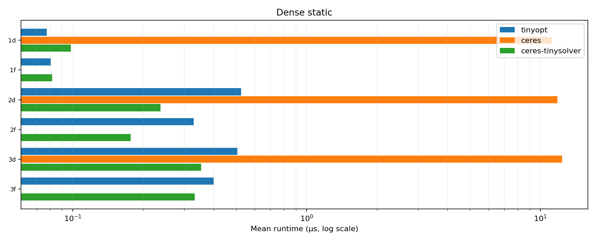

# Tinyopt benchmark report

## Timings

Times are means; **bold** marks the fastest result and *italics* the runner-up. Third-party speedups compare against Tinyopt.

### Dense static

Mean runtime (µs)

| Problem | tinyopt | ceres | ceres-tinysolver | g2o | gtsam |
| --- | --- | --- | --- | --- | --- |
| 1d | **0.08** | 11.18 (0.01x) | *0.10* (0.79x) | — | — |
| 1f | **0.08** | — | *0.08* (0.98x) | — | — |
| 2d | *0.52* | 11.80 (0.04x) | **0.24** (2.21x) | — | — |
| 2f | *0.33* | — | **0.18** (1.86x) | — | — |
| 3d | *0.51* | 12.39 (0.04x) | **0.35** (1.43x) | — | — |
| 3f | *0.40* | — | **0.33** (1.21x) | — | — |
| Mean speedup | — | 63.79x | 0.80x | — | — |

### Dense dynamic

Mean runtime (µs)

| Problem | tinyopt | ceres | ceres-tinysolver | g2o | gtsam |
| --- | --- | --- | --- | --- | --- |
| 1d | *1.17* | 12.09 (0.10x) | **0.74** (1.58x) | — | — |
| 1f | *0.81* | — | **0.64** (1.26x) | — | — |
| 2d | *1.40* | 11.64 (0.12x) | **1.04** (1.35x) | — | — |
| 2f | *1.01* | — | **0.98** (1.02x) | — | — |
| 3d | *1.87* | 12.44 (0.15x) | **1.45** (1.29x) | — | — |
| 3f | **1.13** | — | *1.25* (0.90x) | — | — |
| 6dp | **1.56** | *12.26* (0.13x) | — | — | — |
| 12dp | **3.28** | *17.38* (0.19x) | — | — | — |
| 33dp | **15.48** | *55.03* (0.28x) | — | — | — |
| 50dp | **36.91** | *117.03* (0.32x) | — | — | — |
| Mean speedup | — | 6.46x | 0.84x | — | — |

### Sparse

Mean runtime (ms)

| Problem | tinyopt | ceres | ceres-tinysolver | g2o | gtsam |
| --- | --- | --- | --- | --- | --- |
| 10d | **0.01** | 0.05 (0.12x) | — | *0.02* (0.27x) | 0.27 (0.02x) |
| 100d | **0.08** | 0.39 (0.21x) | — | *0.29* (0.28x) | 2.50 (0.03x) |
| 1000d | *3.87* | 4.04 (0.96x) | — | **3.04** (1.27x) | 18.82 (0.21x) |
| Mean speedup | — | 4.68x | — | 2.68x | 25.44x |

### Robust pose + bundle adjustment

#### Single-threaded

Mean runtime (ms)

| Problem | Setup | tinyopt | ceres | ceres-tinysolver | g2o | gtsam |
| --- | --- | --- | --- | --- | --- | --- |
| Robust pose | 20o Huber | **0.01** | 0.04 (0.19x) | — | *0.03* (0.30x) | 0.20 (0.04x) |
| Robust pose | 20o L2 | **0.05** | *0.13* (0.43x) | — | 0.14 (0.39x) | 0.98 (0.05x) |
| Robust pose | 50o Huber | **0.02** | 0.09 (0.21x) | — | *0.06* (0.32x) | 0.41 (0.04x) |
| Robust pose | 50o L2 | **0.10** | *0.18* (0.55x) | — | 0.57 (0.17x) | 1.41 (0.07x) |
| Robust pose | 100o Huber | **0.03** | 0.17 (0.19x) | — | *0.11* (0.30x) | 0.74 (0.04x) |
| Robust pose | 100o L2 | **0.14** | 0.60 (0.24x) | — | *0.36* (0.39x) | 4.00 (0.04x) |
| Bundle adjustment | 2c 200p | **0.93** | 1.89 (0.49x) | — | *1.63* (0.57x) | 18.02 (0.05x) |
| Bundle adjustment | 2c 200p sparse | **4.76** | — | — | — | — |
| Bundle adjustment | 4c 600p | **2.69** | 8.07 (0.33x) | — | *6.55* (0.41x) | 65.21 (0.04x) |
| Bundle adjustment | 4c 600p sparse | **18.47** | — | — | — | — |
| Bundle adjustment | 10c 3000p | **18.45** | 62.33 (0.30x) | — | *55.38* (0.33x) | 318.82 (0.06x) |
| Bundle adjustment | 10c 3000p sparse | **184.77** | — | — | — | — |
| Bundle adjustment | 100c 50000p | **1490.38** | 3145.05 (0.47x) | — | *1686.34* (0.88x) | — |
| — | Mean speedup | — | 3.42x | — | 2.91x | 21.35x |

#### Multithreaded

Mean runtime (ms)

| Problem | Setup | tinyopt | ceres | ceres-tinysolver | g2o | gtsam |
| --- | --- | --- | --- | --- | --- | --- |
| Bundle adjustment | 100c 50000p MT (1 thread) | **1500.22** | 3076.33 (0.49x) | — | *1728.15* (0.87x) | — |
| Bundle adjustment | 100c 50000p MT (8 thread) | **1091.71** | *1465.63* (0.74x) | — | 1679.02 (0.65x) | — |
| — | Mean speedup | — | 1.70x | — | 1.34x | — |

## Iterations

### Dense

| Problem | Setup | tinyopt | ceres | ceres-tinysolver | g2o | gtsam |
| --- | --- | --- | --- | --- | --- | --- |
| Dense static | 1d | 5 🎯 | 4 🎯 | 4 🎯 | — | — |
| Dense static | 1f | 4 🎯 | — | 3 🎯 | — | — |
| Dense static | 2d | 5 🎯 | 4 🎯 | 4 🎯 | — | — |
| Dense static | 2f | 4 🎯 | — | 3 🎯 | — | — |
| Dense static | 3d | 5 🎯 | 4 🎯 | 4 🎯 | — | — |
| Dense static | 3f | 4 🎯 | — | 3 🎯 | — | — |
| Dense dynamic | 1d | 5 🎯 | 4 🎯 | 4 🎯 | — | — |
| Dense dynamic | 1f | 4 🎯 | — | 3 🎯 | — | — |
| Dense dynamic | 2d | 5 🎯 | 4 🎯 | 4 🎯 | — | — |
| Dense dynamic | 2f | 4 🎯 | — | 3 🎯 | — | — |
| Dense dynamic | 3d | 5 🎯 | 4 🎯 | 4 🎯 | — | — |
| Dense dynamic | 3f | 4 🎯 | — | 3 🎯 | — | — |
| Dense dynamic | 6dp | 3 🎯 | 2 🎯 | — | — | — |
| Dense dynamic | 12dp | 3 🎯 | 2 🎯 | — | — | — |
| Dense dynamic | 33dp | 3 🎯 | 2 🎯 | — | — | — |
| Dense dynamic | 50dp | 3 🎯 | 2 🎯 | — | — | — |
| — | Mean | 4.12 | 3.20 | 3.50 | — | — |

### Sparse

| Problem | tinyopt | ceres | ceres-tinysolver | g2o | gtsam |
| --- | --- | --- | --- | --- | --- |
| 10d | 3 🎯 | 3 🎯 | — | 4 🎯 | 2 🎯 |
| 100d | 3 🎯 | 2 🎯 | — | 4 🎯 | 2 🎯 |
| 1000d | 3 🎯 | 2 🎯 | — | 4 🎯 | 2 🎯 |
| Mean | 3.00 | 2.33 | — | 4.00 | 2.00 |

### Bundle adjustment + robust pose

| Problem | Setup | tinyopt | ceres | ceres-tinysolver | g2o | gtsam |
| --- | --- | --- | --- | --- | --- | --- |
| Bundle adjustment | 2c 200p | 9 🎯 | 7 🎯 | — | 8 🎯 | 8 🎯 |
| Bundle adjustment | 2c 200p sparse | 9 🎯 | — | — | — | — |
| Bundle adjustment | 4c 600p | 5 🎯 | 3 🎯 | — | 4 🎯 | 4 🎯 |
| Bundle adjustment | 4c 600p sparse | 5 🎯 | — | — | — | — |
| Bundle adjustment | 10c 3000p | 5 🎯 | 3 🎯 | — | 3 🎯 | 4 🎯 |
| Bundle adjustment | 10c 3000p sparse | 5 🎯 | — | — | — | — |
| Bundle adjustment | 100c 50000p | 15 🎯 | 13 🎯 | — | 6 🎯 | — |
| Robust pose | 20o Huber | 4 🎯 | 2 🎯 | — | 3 🎯 | 3 🎯 |
| Robust pose | 20o L2 | 22 🎯 | 19 🎯 | — | 25 🎯 | 12 🎯 |
| Robust pose | 50o Huber | 4 🎯 | 2 🎯 | — | 3 🎯 | 3 🎯 |
| Robust pose | 50o L2 | 16 🎯 | 12 🎯 | — | 49 🎯 | 7 🎯 |
| Robust pose | 100o Huber | 4 🎯 | 2 🎯 | — | 3 🎯 | 3 🎯 |
| Robust pose | 100o L2 | 19 🎯 | 17 🎯 | — | 18 🎯 | 18 🎯 |
| — | Mean | 9.38 | 8.00 | — | 12.20 | 6.89 |

### Stopping criteria by problem

| Problem | Setup | tinyopt | ceres | ceres-tinysolver | g2o | gtsam |
| --- | --- | --- | --- | --- | --- | --- |
| Dense static | 1d | cost <1e-14; rel. decrease <1e-6; step² <1e-16; grad² <1e-18; max failures 3; max iter 100 | function <1e-6; gradient <1e-9; parameter <1e-8; max iter 100; min relative decrease 1e-12; max invalid steps 3 | function <1e-6; gradient <1e-9; parameter <1e-8; max iter 100 | — | — |
| Dense static | 1f | cost <1e-6; rel. decrease <1e-6; step² <1e-10; grad² <1e-18; max failures 3; max iter 100 | — | function <1e-6; gradient <1e-5; parameter <1e-5; max iter 100 | — | — |
| Dense static | 2f | cost <1e-6; rel. decrease <1e-6; step² <1e-10; grad² <1e-18; max failures 3; max iter 100 | — | function <1e-6; gradient <1e-5; parameter <1e-5; max iter 100 | — | — |
| Dense static | 2d | cost <1e-14; rel. decrease <1e-6; step² <1e-16; grad² <1e-18; max failures 3; max iter 100 | function <1e-6; gradient <1e-9; parameter <1e-8; max iter 100; min relative decrease 1e-12; max invalid steps 3 | function <1e-6; gradient <1e-9; parameter <1e-8; max iter 100 | — | — |
| Dense static | 3d | cost <1e-14; rel. decrease <1e-6; step² <1e-16; grad² <1e-18; max failures 3; max iter 100 | function <1e-6; gradient <1e-9; parameter <1e-8; max iter 100; min relative decrease 1e-12; max invalid steps 3 | function <1e-6; gradient <1e-9; parameter <1e-8; max iter 100 | — | — |
| Dense static | 3f | cost <1e-6; rel. decrease <1e-6; step² <1e-10; grad² <1e-18; max failures 3; max iter 100 | — | function <1e-6; gradient <1e-5; parameter <1e-5; max iter 100 | — | — |
| Dense dynamic | 1f | cost <1e-6; rel. decrease <1e-6; step² <1e-10; grad² <1e-18; max failures 3; max iter 100 | — | function <1e-6; gradient <1e-5; parameter <1e-5; max iter 100 | — | — |
| Dense dynamic | 1d | cost <1e-14; rel. decrease <1e-6; step² <1e-16; grad² <1e-18; max failures 3; max iter 100 | function <1e-6; gradient <1e-9; parameter <1e-8; max iter 100; min relative decrease 1e-12; max invalid steps 3 | function <1e-6; gradient <1e-9; parameter <1e-8; max iter 100 | — | — |
| Dense dynamic | 2f | cost <1e-6; rel. decrease <1e-6; step² <1e-10; grad² <1e-18; max failures 3; max iter 100 | — | function <1e-6; gradient <1e-5; parameter <1e-5; max iter 100 | — | — |
| Dense dynamic | 2d | cost <1e-14; rel. decrease <1e-6; step² <1e-16; grad² <1e-18; max failures 3; max iter 100 | function <1e-6; gradient <1e-9; parameter <1e-8; max iter 100; min relative decrease 1e-12; max invalid steps 3 | function <1e-6; gradient <1e-9; parameter <1e-8; max iter 100 | — | — |
| Dense dynamic | 3d | cost <1e-14; rel. decrease <1e-6; step² <1e-16; grad² <1e-18; max failures 3; max iter 100 | function <1e-6; gradient <1e-9; parameter <1e-8; max iter 100; min relative decrease 1e-12; max invalid steps 3 | function <1e-6; gradient <1e-9; parameter <1e-8; max iter 100 | — | — |
| Dense dynamic | 3f | cost <1e-6; rel. decrease <1e-6; step² <1e-10; grad² <1e-18; max failures 3; max iter 100 | — | function <1e-6; gradient <1e-5; parameter <1e-5; max iter 100 | — | — |
| Dense dynamic | 6dp | cost <1e-14; rel. decrease <1e-6; step² <1e-16; grad² <1e-18; max failures 3; max iter 20 | function <1e-6; gradient <1e-9; parameter <1e-8; max iter 100; min relative decrease 1e-12; max invalid steps 3 | — | — | — |
| Dense dynamic | 12dp | cost <1e-14; rel. decrease <1e-6; step² <1e-16; grad² <1e-18; max failures 3; max iter 20 | function <1e-6; gradient <1e-9; parameter <1e-8; max iter 100; min relative decrease 1e-12; max invalid steps 3 | — | — | — |
| Dense dynamic | 33dp | cost <1e-14; rel. decrease <1e-6; step² <1e-16; grad² <1e-18; max failures 3; max iter 20 | function <1e-6; gradient <1e-9; parameter <1e-8; max iter 100; min relative decrease 1e-12; max invalid steps 3 | — | — | — |
| Dense dynamic | 50dp | cost <1e-14; rel. decrease <1e-6; step² <1e-16; grad² <1e-18; max failures 3; max iter 20 | function <1e-6; gradient <1e-9; parameter <1e-8; max iter 100; min relative decrease 1e-12; max invalid steps 3 | — | — | — |
| Sparse | 10d | cost <1e-12; rel. decrease <1e-6; step² <1e-16; grad² <1e-18; max failures 3; max iter 100 | function <1e-6; gradient <1e-9; parameter <1e-8; max iter 100; min relative decrease 1e-12; max invalid steps 3 | — | rel. decrease <1e-6 OR step² <1e-16; max trials 3; max iter 100 | cost <1e-12; relative error <1e-6; absolute decrease 0; model fidelity ≥1e-12; max iter 100 |
| Sparse | 100d | cost <1e-12; rel. decrease <1e-6; step² <1e-16; grad² <1e-18; max failures 3; max iter 100 | function <1e-6; gradient <1e-9; parameter <1e-8; max iter 100; min relative decrease 1e-12; max invalid steps 3 | — | rel. decrease <1e-6 OR step² <1e-16; max trials 3; max iter 100 | cost <1e-12; relative error <1e-6; absolute decrease 0; model fidelity ≥1e-12; max iter 100 |
| Sparse | 1000d | cost <1e-12; rel. decrease <1e-6; step² <1e-16; grad² <1e-18; max failures 3; max iter 100 | function <1e-6; gradient <1e-9; parameter <1e-8; max iter 100; min relative decrease 1e-12; max invalid steps 3 | — | rel. decrease <1e-6 OR step² <1e-16; max trials 3; max iter 100 | cost <1e-12; relative error <1e-6; absolute decrease 0; model fidelity ≥1e-12; max iter 100 |
| Bundle adjustment | 2c 200p | cost <1e-12; rel. decrease <1e-6; step² <1e-16; grad² <1e-18; max failures 3; max iter 100 | function <1e-6; gradient <1e-9; parameter <1e-8; max iter 100; min relative decrease 1e-12; max invalid steps 3 | — | rel. decrease <1e-6 OR step² <1e-16; max trials 3; max iter 100 | cost <1e-12; relative error <1e-6; absolute decrease 0; model fidelity ≥1e-12; max iter 100 |
| Bundle adjustment | 2c 200p sparse | cost <1e-12; rel. decrease <1e-6; step² <1e-16; grad² <1e-18; max failures 3; max iter 100 | — | — | — | — |
| Bundle adjustment | 4c 600p | cost <1e-12; rel. decrease <1e-6; step² <1e-16; grad² <1e-18; max failures 3; max iter 100 | function <1e-6; gradient <1e-9; parameter <1e-8; max iter 100; min relative decrease 1e-12; max invalid steps 3 | — | rel. decrease <1e-6 OR step² <1e-16; max trials 3; max iter 100 | cost <1e-12; relative error <1e-6; absolute decrease 0; model fidelity ≥1e-12; max iter 100 |
| Bundle adjustment | 4c 600p sparse | cost <1e-12; rel. decrease <1e-6; step² <1e-16; grad² <1e-18; max failures 3; max iter 100 | — | — | — | — |
| Bundle adjustment | 10c 3000p | cost <1e-12; rel. decrease <1e-6; step² <1e-16; grad² <1e-18; max failures 3; max iter 100 | function <1e-6; gradient <1e-9; parameter <1e-8; max iter 100; min relative decrease 1e-12; max invalid steps 3 | — | rel. decrease <1e-6 OR step² <1e-16; max trials 3; max iter 100 | cost <1e-12; relative error <1e-6; absolute decrease 0; model fidelity ≥1e-12; max iter 100 |
| Bundle adjustment | 10c 3000p sparse | cost <1e-12; rel. decrease <1e-6; step² <1e-16; grad² <1e-18; max failures 3; max iter 100 | — | — | — | — |
| Bundle adjustment | 100c 50000p | cost <1e-12; rel. decrease <1e-6; step² <1e-16; grad² <1e-18; max failures 3; max iter 100 | function <1e-6; gradient <1e-9; parameter <1e-8; max iter 100; min relative decrease 1e-12; max invalid steps 3 | — | rel. decrease <1e-6 OR step² <1e-16; max trials 3; max iter 100 | — |
| Robust pose | 20o Huber | cost <1e-12; rel. decrease <1e-6; step² <1e-16; grad² <1e-18; max failures 20; max iter 100 | function <1e-6; gradient <1e-9; parameter <1e-8; max iter 100; min relative decrease 1e-12; max invalid steps 20 | — | rel. decrease <1e-6 OR step² <1e-16; max trials 20; max iter 1000 | cost <1e-12; relative error <1e-6; absolute decrease 0; model fidelity ≥1e-12; max iter 100 |
| Robust pose | 20o L2 | cost <1e-12; rel. decrease <1e-6; step² <1e-16; grad² <1e-18; max failures 20; max iter 100 | function <1e-6; gradient <1e-9; parameter <1e-8; max iter 100; min relative decrease 1e-12; max invalid steps 20 | — | rel. decrease <1e-6 OR step² <1e-16; max trials 20; max iter 1000 | cost <1e-12; relative error <1e-6; absolute decrease 0; model fidelity ≥1e-12; max iter 100 |
| Robust pose | 50o Huber | cost <1e-12; rel. decrease <1e-6; step² <1e-16; grad² <1e-18; max failures 20; max iter 100 | function <1e-6; gradient <1e-9; parameter <1e-8; max iter 100; min relative decrease 1e-12; max invalid steps 20 | — | rel. decrease <1e-6 OR step² <1e-16; max trials 20; max iter 1000 | cost <1e-12; relative error <1e-6; absolute decrease 0; model fidelity ≥1e-12; max iter 100 |
| Robust pose | 50o L2 | cost <1e-12; rel. decrease <1e-6; step² <1e-16; grad² <1e-18; max failures 20; max iter 100 | function <1e-6; gradient <1e-9; parameter <1e-8; max iter 100; min relative decrease 1e-12; max invalid steps 20 | — | rel. decrease <1e-6 OR step² <1e-16; max trials 20; max iter 1000 | cost <1e-12; relative error <1e-6; absolute decrease 0; model fidelity ≥1e-12; max iter 100 |
| Robust pose | 100o Huber | cost <1e-12; rel. decrease <1e-6; step² <1e-16; grad² <1e-18; max failures 20; max iter 100 | function <1e-6; gradient <1e-9; parameter <1e-8; max iter 100; min relative decrease 1e-12; max invalid steps 20 | — | rel. decrease <1e-6 OR step² <1e-16; max trials 20; max iter 1000 | cost <1e-12; relative error <1e-6; absolute decrease 0; model fidelity ≥1e-12; max iter 100 |
| Robust pose | 100o L2 | cost <1e-12; rel. decrease <1e-6; step² <1e-16; grad² <1e-18; max failures 20; max iter 100 | function <1e-6; gradient <1e-9; parameter <1e-8; max iter 100; min relative decrease 1e-12; max invalid steps 20 | — | rel. decrease <1e-6 OR step² <1e-16; max trials 20; max iter 1000 | cost <1e-12; relative error <1e-6; absolute decrease 0; model fidelity ≥1e-12; max iter 100 |

## System and build configuration

- **Architecture:** x86_64
- **Platform:** Linux-6.8.0-31-generic-x86_64-with-glibc2.39
- **Python:** 3.12.14
- **CMAKE_BUILD_TYPE:** Release
- **CMAKE_CXX_COMPILER:** /home/julien/dev/eta/tinyopt2/.pixi/envs/bench-all/bin/c++
- **CMAKE_CXX_FLAGS:** 
- **CMAKE_CXX_FLAGS_RELEASE:** -O3 -DNDEBUG
- **CMAKE_GENERATOR:** Ninja
- **TINYOPT_BUILD_BENCHMARKS:** ON
- **TINYOPT_BUILD_CERES:** ON
- **TINYOPT_BUILD_G2O_BENCHMARKS:** ON
- **TINYOPT_BUILD_GTSAM_BENCHMARKS:** ON
- **TINYOPT_BUILD_TESTS:** ON
- **TINYOPT_ENFORCE_NO_DYNAMIC_ALLOCATIONS:** OFF
