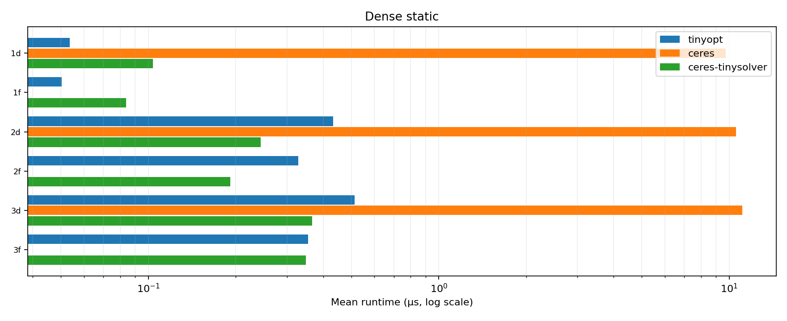
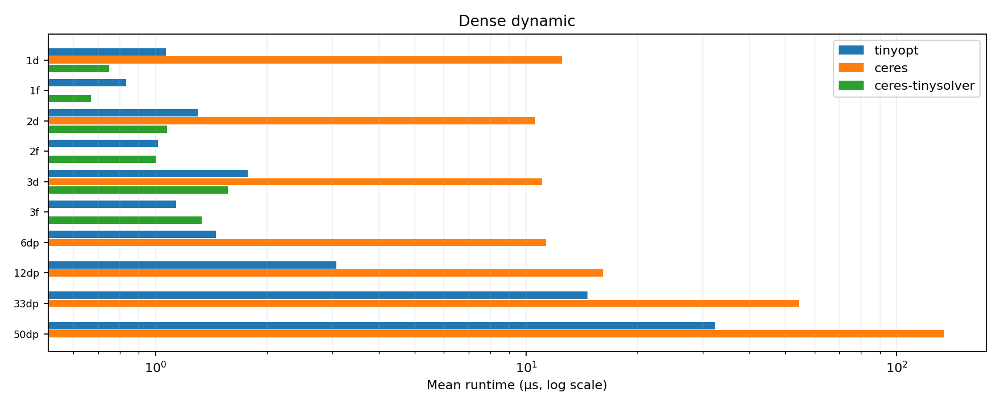
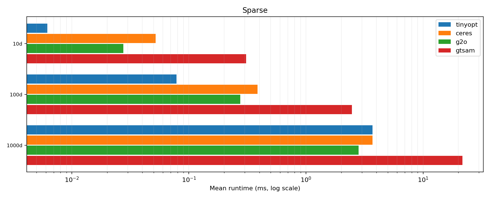
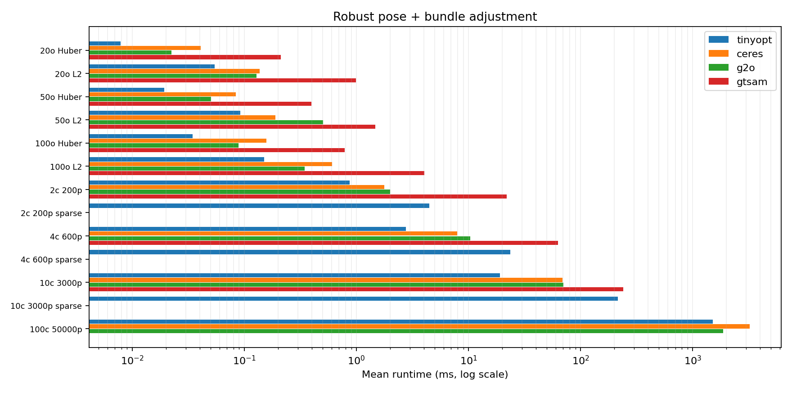

# Tinyopt benchmark report

## Timings

Times are means; **bold** marks the fastest result and *italics* the runner-up. Third-party speedups compare against Tinyopt.

### Dense static

Mean runtime (µs)

| Problem | tinyopt | ceres | ceres-tinysolver | g2o | gtsam |
| --- | --- | --- | --- | --- | --- |
| 1d | **0.05** | 9.71 (0.01x) | *0.10* (0.52x) | — | — |
| 1f | **0.05** | — | *0.08* (0.60x) | — | — |
| 2d | *0.43* | 10.55 (0.04x) | **0.24** (1.77x) | — | — |
| 2f | *0.33* | — | **0.19** (1.72x) | — | — |
| 3d | *0.51* | 11.09 (0.05x) | **0.37** (1.40x) | — | — |
| 3f | *0.36* | — | **0.35** (1.02x) | — | — |
| Mean speedup | — | 75.76x | 1.07x | — | — |

### Dense dynamic

Mean runtime (µs)

| Problem | tinyopt | ceres | ceres-tinysolver | g2o | gtsam |
| --- | --- | --- | --- | --- | --- |
| 1d | *1.07* | 12.49 (0.09x) | **0.75** (1.42x) | — | — |
| 1f | *0.83* | — | **0.67** (1.25x) | — | — |
| 2d | *1.30* | 10.59 (0.12x) | **1.07** (1.21x) | — | — |
| 2f | *1.01* | — | **1.00** (1.01x) | — | — |
| 3d | *1.77* | 11.02 (0.16x) | **1.57** (1.13x) | — | — |
| 3f | **1.13** | — | *1.33* (0.85x) | — | — |
| 6dp | **1.46** | *11.31* (0.13x) | — | — | — |
| 12dp | **3.08** | *16.10* (0.19x) | — | — | — |
| 33dp | **14.63** | *54.35* (0.27x) | — | — | — |
| 50dp | **32.27** | *133.84* (0.24x) | — | — | — |
| Mean speedup | — | 6.70x | 0.90x | — | — |

### Sparse

Mean runtime (ms)

| Problem | tinyopt | ceres | ceres-tinysolver | g2o | gtsam |
| --- | --- | --- | --- | --- | --- |
| 10d | **0.01** | 0.05 (0.12x) | — | *0.03* (0.23x) | 0.31 (0.02x) |
| 100d | **0.08** | 0.39 (0.20x) | — | *0.27* (0.29x) | 2.46 (0.03x) |
| 1000d | *3.71* | 3.71 (1.00x) | — | **2.81** (1.32x) | 21.75 (0.17x) |
| Mean speedup | — | 4.77x | — | 2.90x | 29.00x |

### Robust pose + bundle adjustment

Mean runtime (ms)

| Problem | Setup | tinyopt | ceres | ceres-tinysolver | g2o | gtsam |
| --- | --- | --- | --- | --- | --- | --- |
| Robust pose | 20o Huber | **0.01** | 0.04 (0.19x) | — | *0.02* (0.35x) | 0.21 (0.04x) |
| Robust pose | 20o L2 | **0.05** | 0.14 (0.39x) | — | *0.13* (0.42x) | 0.99 (0.05x) |
| Robust pose | 50o Huber | **0.02** | 0.08 (0.23x) | — | *0.05* (0.39x) | 0.40 (0.05x) |
| Robust pose | 50o L2 | **0.09** | *0.19* (0.48x) | — | 0.51 (0.18x) | 1.47 (0.06x) |
| Robust pose | 100o Huber | **0.03** | 0.16 (0.22x) | — | *0.09* (0.39x) | 0.79 (0.04x) |
| Robust pose | 100o L2 | **0.15** | 0.61 (0.25x) | — | *0.35* (0.44x) | 4.05 (0.04x) |
| Bundle adjustment | 2c 200p | **0.87** | *1.78* (0.49x) | — | 1.99 (0.44x) | 21.95 (0.04x) |
| Bundle adjustment | 2c 200p sparse | **4.49** | — | — | — | — |
| Bundle adjustment | 4c 600p | **2.76** | *7.97* (0.35x) | — | 10.39 (0.27x) | 63.17 (0.04x) |
| Bundle adjustment | 4c 600p sparse | **23.61** | — | — | — | — |
| Bundle adjustment | 10c 3000p | **19.10** | *69.14* (0.28x) | — | 70.21 (0.27x) | 241.26 (0.08x) |
| Bundle adjustment | 10c 3000p sparse | **215.89** | — | — | — | — |
| Bundle adjustment | 100c 50000p | **1509.59** | 3235.45 (0.47x) | — | *1868.97* (0.81x) | — |
| — | Mean speedup | — | 3.34x | — | 2.92x | 21.31x |

## Iterations

### Dense

| Problem | Setup | tinyopt | ceres | ceres-tinysolver | g2o | gtsam |
| --- | --- | --- | --- | --- | --- | --- |
| Dense static | 1d | 5 🎯 | 4 🎯 | 4 🎯 | — | — |
| Dense static | 1f | 4 🎯 | — | 3 🎯 | — | — |
| Dense static | 2d | 5 🎯 | 4 🎯 | 4 🎯 | — | — |
| Dense static | 2f | 4 🎯 | — | 3 🎯 | — | — |
| Dense static | 3d | 5 🎯 | 4 🎯 | 4 🎯 | — | — |
| Dense static | 3f | 4 🎯 | — | 3 🎯 | — | — |
| Dense dynamic | 1d | 5 🎯 | 4 🎯 | 4 🎯 | — | — |
| Dense dynamic | 1f | 4 🎯 | — | 3 🎯 | — | — |
| Dense dynamic | 2d | 5 🎯 | 4 🎯 | 4 🎯 | — | — |
| Dense dynamic | 2f | 4 🎯 | — | 3 🎯 | — | — |
| Dense dynamic | 3d | 5 🎯 | 4 🎯 | 4 🎯 | — | — |
| Dense dynamic | 3f | 4 🎯 | — | 3 🎯 | — | — |
| Dense dynamic | 6dp | 3 🎯 | 2 🎯 | — | — | — |
| Dense dynamic | 12dp | 3 🎯 | 2 🎯 | — | — | — |
| Dense dynamic | 33dp | 3 🎯 | 2 🎯 | — | — | — |
| Dense dynamic | 50dp | 3 🎯 | 2 🎯 | — | — | — |
| — | Mean | 4.12 | 3.20 | 3.50 | — | — |

### Sparse

| Problem | tinyopt | ceres | ceres-tinysolver | g2o | gtsam |
| --- | --- | --- | --- | --- | --- |
| 10d | 3 🎯 | 3 🎯 | — | 4 🎯 | 2 🎯 |
| 100d | 3 🎯 | 2 🎯 | — | 4 🎯 | 2 🎯 |
| 1000d | 3 🎯 | 2 🎯 | — | 4 🎯 | 2 🎯 |
| Mean | 3.00 | 2.33 | — | 4.00 | 2.00 |

### Bundle adjustment + robust pose

| Problem | Setup | tinyopt | ceres | ceres-tinysolver | g2o | gtsam |
| --- | --- | --- | --- | --- | --- | --- |
| Bundle adjustment | 2c 200p | 9 🎯 | 7 🎯 | — | 8 🎯 | 8 🎯 |
| Bundle adjustment | 2c 200p sparse | 9 🎯 | — | — | — | — |
| Bundle adjustment | 4c 600p | 5 🎯 | 3 🎯 | — | 4 🎯 | 4 🎯 |
| Bundle adjustment | 4c 600p sparse | 5 🎯 | — | — | — | — |
| Bundle adjustment | 10c 3000p | 5 🎯 | 3 🎯 | — | 3 🎯 | 4 🎯 |
| Bundle adjustment | 10c 3000p sparse | 5 🎯 | — | — | — | — |
| Bundle adjustment | 100c 50000p | 15 🎯 | 13 🎯 | — | 6 🎯 | — |
| Robust pose | 20o Huber | 4 🎯 | 2 🎯 | — | 3 🎯 | 3 🎯 |
| Robust pose | 20o L2 | 22 🎯 | 19 🎯 | — | 25 🎯 | 12 🎯 |
| Robust pose | 50o Huber | 4 🎯 | 2 🎯 | — | 3 🎯 | 3 🎯 |
| Robust pose | 50o L2 | 16 🎯 | 12 🎯 | — | 49 🎯 | 7 🎯 |
| Robust pose | 100o Huber | 4 🎯 | 2 🎯 | — | 3 🎯 | 3 🎯 |
| Robust pose | 100o L2 | 19 🎯 | 17 🎯 | — | 18 🎯 | 18 🎯 |
| — | Mean | 9.38 | 8.00 | — | 12.20 | 6.89 |

### Stopping criteria by problem

| Problem | Setup | tinyopt | ceres | ceres-tinysolver | g2o | gtsam |
| --- | --- | --- | --- | --- | --- | --- |
| Dense static | 1d | cost <1e-14; rel. decrease <1e-6; step² <1e-16; grad² <1e-18; max failures 3; max iter 100 | function <1e-6; gradient <1e-9; parameter <1e-8; max iter 100; min relative decrease 1e-12; max invalid steps 3 | function <1e-6; gradient <1e-9; parameter <1e-8; max iter 100 | — | — |
| Dense static | 1f | cost <1e-6; rel. decrease <1e-6; step² <1e-10; grad² <1e-18; max failures 3; max iter 100 | — | function <1e-6; gradient <1e-5; parameter <1e-5; max iter 100 | — | — |
| Dense static | 2d | cost <1e-14; rel. decrease <1e-6; step² <1e-16; grad² <1e-18; max failures 3; max iter 100 | function <1e-6; gradient <1e-9; parameter <1e-8; max iter 100; min relative decrease 1e-12; max invalid steps 3 | function <1e-6; gradient <1e-9; parameter <1e-8; max iter 100 | — | — |
| Dense static | 2f | cost <1e-6; rel. decrease <1e-6; step² <1e-10; grad² <1e-18; max failures 3; max iter 100 | — | function <1e-6; gradient <1e-5; parameter <1e-5; max iter 100 | — | — |
| Dense static | 3d | cost <1e-14; rel. decrease <1e-6; step² <1e-16; grad² <1e-18; max failures 3; max iter 100 | function <1e-6; gradient <1e-9; parameter <1e-8; max iter 100; min relative decrease 1e-12; max invalid steps 3 | function <1e-6; gradient <1e-9; parameter <1e-8; max iter 100 | — | — |
| Dense static | 3f | cost <1e-6; rel. decrease <1e-6; step² <1e-10; grad² <1e-18; max failures 3; max iter 100 | — | function <1e-6; gradient <1e-5; parameter <1e-5; max iter 100 | — | — |
| Dense dynamic | 1d | cost <1e-14; rel. decrease <1e-6; step² <1e-16; grad² <1e-18; max failures 3; max iter 100 | function <1e-6; gradient <1e-9; parameter <1e-8; max iter 100; min relative decrease 1e-12; max invalid steps 3 | function <1e-6; gradient <1e-9; parameter <1e-8; max iter 100 | — | — |
| Dense dynamic | 1f | cost <1e-6; rel. decrease <1e-6; step² <1e-10; grad² <1e-18; max failures 3; max iter 100 | — | function <1e-6; gradient <1e-5; parameter <1e-5; max iter 100 | — | — |
| Dense dynamic | 2d | cost <1e-14; rel. decrease <1e-6; step² <1e-16; grad² <1e-18; max failures 3; max iter 100 | function <1e-6; gradient <1e-9; parameter <1e-8; max iter 100; min relative decrease 1e-12; max invalid steps 3 | function <1e-6; gradient <1e-9; parameter <1e-8; max iter 100 | — | — |
| Dense dynamic | 2f | cost <1e-6; rel. decrease <1e-6; step² <1e-10; grad² <1e-18; max failures 3; max iter 100 | — | function <1e-6; gradient <1e-5; parameter <1e-5; max iter 100 | — | — |
| Dense dynamic | 3d | cost <1e-14; rel. decrease <1e-6; step² <1e-16; grad² <1e-18; max failures 3; max iter 100 | function <1e-6; gradient <1e-9; parameter <1e-8; max iter 100; min relative decrease 1e-12; max invalid steps 3 | function <1e-6; gradient <1e-9; parameter <1e-8; max iter 100 | — | — |
| Dense dynamic | 3f | cost <1e-6; rel. decrease <1e-6; step² <1e-10; grad² <1e-18; max failures 3; max iter 100 | — | function <1e-6; gradient <1e-5; parameter <1e-5; max iter 100 | — | — |
| Dense dynamic | 6dp | cost <1e-14; rel. decrease <1e-6; step² <1e-16; grad² <1e-18; max failures 3; max iter 20 | function <1e-6; gradient <1e-9; parameter <1e-8; max iter 100; min relative decrease 1e-12; max invalid steps 3 | — | — | — |
| Dense dynamic | 12dp | cost <1e-14; rel. decrease <1e-6; step² <1e-16; grad² <1e-18; max failures 3; max iter 20 | function <1e-6; gradient <1e-9; parameter <1e-8; max iter 100; min relative decrease 1e-12; max invalid steps 3 | — | — | — |
| Dense dynamic | 33dp | cost <1e-14; rel. decrease <1e-6; step² <1e-16; grad² <1e-18; max failures 3; max iter 20 | function <1e-6; gradient <1e-9; parameter <1e-8; max iter 100; min relative decrease 1e-12; max invalid steps 3 | — | — | — |
| Dense dynamic | 50dp | cost <1e-14; rel. decrease <1e-6; step² <1e-16; grad² <1e-18; max failures 3; max iter 20 | function <1e-6; gradient <1e-9; parameter <1e-8; max iter 100; min relative decrease 1e-12; max invalid steps 3 | — | — | — |
| Sparse | 10d | cost <1e-12; rel. decrease <1e-6; step² <1e-16; grad² <1e-18; max failures 3; max iter 100 | function <1e-6; gradient <1e-9; parameter <1e-8; max iter 100; min relative decrease 1e-12; max invalid steps 3 | — | rel. decrease <1e-6 OR step² <1e-16; max trials 3; max iter 100 | cost <1e-12; relative error <1e-6; absolute decrease 0; model fidelity ≥1e-12; max iter 100 |
| Sparse | 100d | cost <1e-12; rel. decrease <1e-6; step² <1e-16; grad² <1e-18; max failures 3; max iter 100 | function <1e-6; gradient <1e-9; parameter <1e-8; max iter 100; min relative decrease 1e-12; max invalid steps 3 | — | rel. decrease <1e-6 OR step² <1e-16; max trials 3; max iter 100 | cost <1e-12; relative error <1e-6; absolute decrease 0; model fidelity ≥1e-12; max iter 100 |
| Sparse | 1000d | cost <1e-12; rel. decrease <1e-6; step² <1e-16; grad² <1e-18; max failures 3; max iter 100 | function <1e-6; gradient <1e-9; parameter <1e-8; max iter 100; min relative decrease 1e-12; max invalid steps 3 | — | rel. decrease <1e-6 OR step² <1e-16; max trials 3; max iter 100 | cost <1e-12; relative error <1e-6; absolute decrease 0; model fidelity ≥1e-12; max iter 100 |
| Bundle adjustment | 2c 200p | cost <1e-12; rel. decrease <1e-6; step² <1e-16; grad² <1e-18; max failures 3; max iter 100 | function <1e-6; gradient <1e-9; parameter <1e-8; max iter 100; min relative decrease 1e-12; max invalid steps 3 | — | rel. decrease <1e-6 OR step² <1e-16; max trials 3; max iter 100 | cost <1e-12; relative error <1e-6; absolute decrease 0; model fidelity ≥1e-12; max iter 100 |
| Bundle adjustment | 2c 200p sparse | cost <1e-12; rel. decrease <1e-6; step² <1e-16; grad² <1e-18; max failures 3; max iter 100 | — | — | — | — |
| Bundle adjustment | 4c 600p | cost <1e-12; rel. decrease <1e-6; step² <1e-16; grad² <1e-18; max failures 3; max iter 100 | function <1e-6; gradient <1e-9; parameter <1e-8; max iter 100; min relative decrease 1e-12; max invalid steps 3 | — | rel. decrease <1e-6 OR step² <1e-16; max trials 3; max iter 100 | cost <1e-12; relative error <1e-6; absolute decrease 0; model fidelity ≥1e-12; max iter 100 |
| Bundle adjustment | 4c 600p sparse | cost <1e-12; rel. decrease <1e-6; step² <1e-16; grad² <1e-18; max failures 3; max iter 100 | — | — | — | — |
| Bundle adjustment | 10c 3000p | cost <1e-12; rel. decrease <1e-6; step² <1e-16; grad² <1e-18; max failures 3; max iter 100 | function <1e-6; gradient <1e-9; parameter <1e-8; max iter 100; min relative decrease 1e-12; max invalid steps 3 | — | rel. decrease <1e-6 OR step² <1e-16; max trials 3; max iter 100 | cost <1e-12; relative error <1e-6; absolute decrease 0; model fidelity ≥1e-12; max iter 100 |
| Bundle adjustment | 10c 3000p sparse | cost <1e-12; rel. decrease <1e-6; step² <1e-16; grad² <1e-18; max failures 3; max iter 100 | — | — | — | — |
| Bundle adjustment | 100c 50000p | cost <1e-12; rel. decrease <1e-6; step² <1e-16; grad² <1e-18; max failures 3; max iter 100 | function <1e-6; gradient <1e-9; parameter <1e-8; max iter 100; min relative decrease 1e-12; max invalid steps 3 | — | rel. decrease <1e-6 OR step² <1e-16; max trials 3; max iter 100 | — |
| Robust pose | 20o Huber | cost <1e-12; rel. decrease <1e-6; step² <1e-16; grad² <1e-18; max failures 20; max iter 100 | function <1e-6; gradient <1e-9; parameter <1e-8; max iter 100; min relative decrease 1e-12; max invalid steps 20 | — | rel. decrease <1e-6 OR step² <1e-16; max trials 20; max iter 1000 | cost <1e-12; relative error <1e-6; absolute decrease 0; model fidelity ≥1e-12; max iter 100 |
| Robust pose | 20o L2 | cost <1e-12; rel. decrease <1e-6; step² <1e-16; grad² <1e-18; max failures 20; max iter 100 | function <1e-6; gradient <1e-9; parameter <1e-8; max iter 100; min relative decrease 1e-12; max invalid steps 20 | — | rel. decrease <1e-6 OR step² <1e-16; max trials 20; max iter 1000 | cost <1e-12; relative error <1e-6; absolute decrease 0; model fidelity ≥1e-12; max iter 100 |
| Robust pose | 50o Huber | cost <1e-12; rel. decrease <1e-6; step² <1e-16; grad² <1e-18; max failures 20; max iter 100 | function <1e-6; gradient <1e-9; parameter <1e-8; max iter 100; min relative decrease 1e-12; max invalid steps 20 | — | rel. decrease <1e-6 OR step² <1e-16; max trials 20; max iter 1000 | cost <1e-12; relative error <1e-6; absolute decrease 0; model fidelity ≥1e-12; max iter 100 |
| Robust pose | 50o L2 | cost <1e-12; rel. decrease <1e-6; step² <1e-16; grad² <1e-18; max failures 20; max iter 100 | function <1e-6; gradient <1e-9; parameter <1e-8; max iter 100; min relative decrease 1e-12; max invalid steps 20 | — | rel. decrease <1e-6 OR step² <1e-16; max trials 20; max iter 1000 | cost <1e-12; relative error <1e-6; absolute decrease 0; model fidelity ≥1e-12; max iter 100 |
| Robust pose | 100o Huber | cost <1e-12; rel. decrease <1e-6; step² <1e-16; grad² <1e-18; max failures 20; max iter 100 | function <1e-6; gradient <1e-9; parameter <1e-8; max iter 100; min relative decrease 1e-12; max invalid steps 20 | — | rel. decrease <1e-6 OR step² <1e-16; max trials 20; max iter 1000 | cost <1e-12; relative error <1e-6; absolute decrease 0; model fidelity ≥1e-12; max iter 100 |
| Robust pose | 100o L2 | cost <1e-12; rel. decrease <1e-6; step² <1e-16; grad² <1e-18; max failures 20; max iter 100 | function <1e-6; gradient <1e-9; parameter <1e-8; max iter 100; min relative decrease 1e-12; max invalid steps 20 | — | rel. decrease <1e-6 OR step² <1e-16; max trials 20; max iter 1000 | cost <1e-12; relative error <1e-6; absolute decrease 0; model fidelity ≥1e-12; max iter 100 |

## System and build configuration

- **Architecture:** x86_64
- **Platform:** Linux-6.8.0-31-generic-x86_64-with-glibc2.39
- **Python:** 3.12.14
- **CMAKE_BUILD_TYPE:** Release
- **CMAKE_CXX_COMPILER:** /home/julien/dev/eta/tinyopt/.pixi/envs/bench-all/bin/c++
- **CMAKE_CXX_FLAGS:** 
- **CMAKE_CXX_FLAGS_RELEASE:** -O3 -DNDEBUG
- **CMAKE_GENERATOR:** Ninja
- **TINYOPT_BUILD_BENCHMARKS:** ON
- **TINYOPT_BUILD_CERES:** ON
- **TINYOPT_BUILD_G2O_BENCHMARKS:** ON
- **TINYOPT_BUILD_GTSAM_BENCHMARKS:** ON
- **TINYOPT_BUILD_TESTS:** ON
- **TINYOPT_ENFORCE_NO_DYNAMIC_ALLOCATIONS:** OFF
