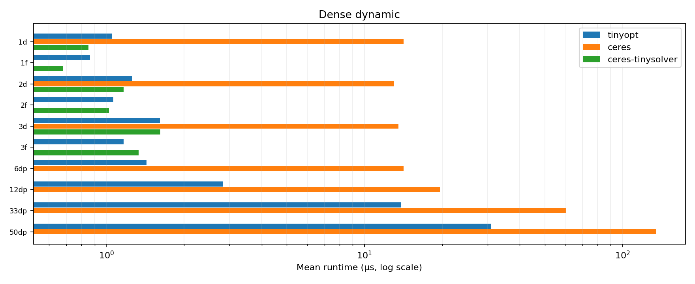
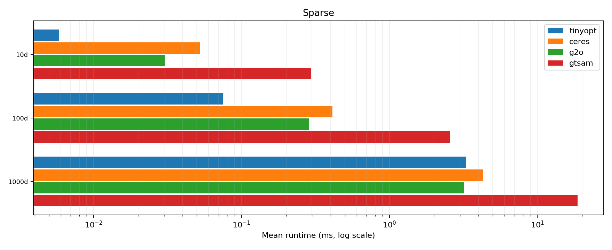
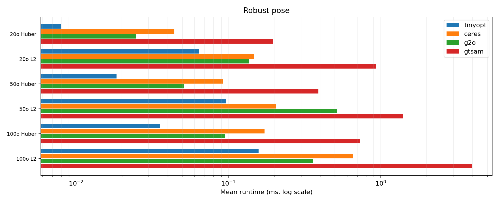
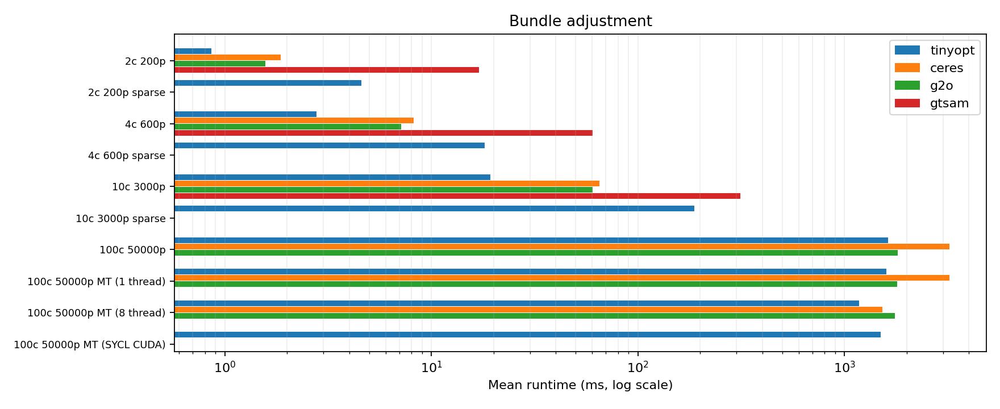

# Tinyopt benchmark report

## Timings

Times are means; **bold** marks the fastest result and *italics* the runner-up. Third-party speedups compare against Tinyopt.

### Dense static

Mean runtime (µs)

| Problem | tinyopt | ceres | ceres-tinysolver | g2o | gtsam |
| --- | --- | --- | --- | --- | --- |
| 1d | **0.06** | 12.37 (0.00x) | *0.10* (0.60x) | — | — |
| 1f | **0.07** | — | *0.09* (0.78x) | — | — |
| 2d | *0.47* | 13.17 (0.04x) | **0.25** (1.89x) | — | — |
| 2f | *0.34* | — | **0.18** (1.82x) | — | — |
| 3d | *0.51* | 13.47 (0.04x) | **0.38** (1.35x) | — | — |
| 3f | *0.38* | — | **0.35** (1.08x) | — | — |
| Mean speedup | — | 85.04x | 0.95x | — | — |

### Dense dynamic

Mean runtime (µs)

| Problem | tinyopt | ceres | ceres-tinysolver | g2o | gtsam |
| --- | --- | --- | --- | --- | --- |
| 1d | *1.05* | 14.20 (0.07x) | **0.85** (1.24x) | — | — |
| 1f | *0.86* | — | **0.68** (1.27x) | — | — |
| 2d | *1.26* | 13.01 (0.10x) | **1.16** (1.08x) | — | — |
| 2f | *1.07* | — | **1.02** (1.04x) | — | — |
| 3d | **1.61** | 13.56 (0.12x) | *1.62* (1.00x) | — | — |
| 3f | **1.16** | — | *1.33* (0.87x) | — | — |
| 6dp | **1.43** | *14.19* (0.10x) | — | — | — |
| 12dp | **2.84** | *19.58* (0.14x) | — | — | — |
| 33dp | **13.88** | *60.33* (0.23x) | — | — | — |
| 50dp | **30.92** | *134.74* (0.23x) | — | — | — |
| Mean speedup | — | 8.25x | 0.94x | — | — |

### Sparse

Mean runtime (ms)

| Problem | tinyopt | ceres | ceres-tinysolver | g2o | gtsam |
| --- | --- | --- | --- | --- | --- |
| 10d | **0.01** | 0.05 (0.11x) | — | *0.03* (0.19x) | 0.29 (0.02x) |
| 100d | **0.07** | 0.41 (0.18x) | — | *0.28* (0.26x) | 2.58 (0.03x) |
| 1000d | *3.29* | 4.29 (0.77x) | — | **3.19** (1.03x) | 18.74 (0.18x) |
| Mean speedup | — | 5.25x | — | 3.32x | 30.07x |

### Robust pose

Mean runtime (ms)

| Problem | tinyopt | ceres | ceres-tinysolver | g2o | gtsam |
| --- | --- | --- | --- | --- | --- |
| 20o Huber | **0.01** | 0.04 (0.18x) | — | *0.02* (0.32x) | 0.20 (0.04x) |
| 20o L2 | **0.06** | 0.15 (0.44x) | — | *0.14* (0.48x) | 0.93 (0.07x) |
| 50o Huber | **0.02** | 0.09 (0.20x) | — | *0.05* (0.36x) | 0.39 (0.05x) |
| 50o L2 | **0.10** | *0.20* (0.47x) | — | 0.51 (0.19x) | 1.40 (0.07x) |
| 100o Huber | **0.04** | 0.17 (0.21x) | — | *0.10* (0.38x) | 0.73 (0.05x) |
| 100o L2 | **0.16** | 0.66 (0.24x) | — | *0.36* (0.44x) | 3.95 (0.04x) |
| Mean speedup | — | 3.98x | — | 3.03x | 20.00x |

### Bundle adjustment

#### Single-threaded

Mean runtime (ms)

| Problem | tinyopt | ceres | ceres-tinysolver | g2o | gtsam |
| --- | --- | --- | --- | --- | --- |
| 2c 200p | **0.86** | 1.87 (0.46x) | — | *1.57* (0.55x) | 16.98 (0.05x) |
| 2c 200p sparse | **4.57** | — | — | — | — |
| 4c 600p | **2.77** | 8.19 (0.34x) | — | *7.14* (0.39x) | 60.39 (0.05x) |
| 4c 600p sparse | **18.09** | — | — | — | — |
| 10c 3000p | **19.33** | 65.08 (0.30x) | — | *60.43* (0.32x) | 312.24 (0.06x) |
| 10c 3000p sparse | **187.78** | — | — | — | — |
| 100c 50000p | **1622.66** | 3222.14 (0.50x) | — | *1805.05* (0.90x) | — |
| Mean speedup | — | 2.62x | — | 2.16x | 19.23x |

#### Multithreaded full BA (host solve)

Mean runtime (ms)

| Problem | tinyopt | ceres | ceres-tinysolver | g2o | gtsam |
| --- | --- | --- | --- | --- | --- |
| 100c 50000p MT (1 thread) | **1590.55** | 3214.97 (0.49x) | — | *1794.52* (0.89x) | — |
| 100c 50000p MT (8 thread) | **1178.89** | *1525.58* (0.77x) | — | 1758.60 (0.67x) | — |
| 100c 50000p MT (SYCL CUDA) | **1499.50** | — | — | — | — |
| Mean speedup | — | 1.66x | — | 1.31x | — |

## Iterations

### Dense

| Problem | Setup | tinyopt | ceres | ceres-tinysolver | g2o | gtsam |
| --- | --- | --- | --- | --- | --- | --- |
| Dense static | 1d | 5 🎯 | 4 🎯 | 4 🎯 | — | — |
| Dense static | 1f | 4 🎯 | — | 3 🎯 | — | — |
| Dense static | 2d | 5 🎯 | 4 🎯 | 4 🎯 | — | — |
| Dense static | 2f | 4 🎯 | — | 3 🎯 | — | — |
| Dense static | 3d | 5 🎯 | 4 🎯 | 4 🎯 | — | — |
| Dense static | 3f | 4 🎯 | — | 3 🎯 | — | — |
| Dense dynamic | 1d | 5 🎯 | 4 🎯 | 4 🎯 | — | — |
| Dense dynamic | 1f | 4 🎯 | — | 3 🎯 | — | — |
| Dense dynamic | 2d | 5 🎯 | 4 🎯 | 4 🎯 | — | — |
| Dense dynamic | 2f | 4 🎯 | — | 3 🎯 | — | — |
| Dense dynamic | 3d | 5 🎯 | 4 🎯 | 4 🎯 | — | — |
| Dense dynamic | 3f | 4 🎯 | — | 3 🎯 | — | — |
| Dense dynamic | 6dp | 3 🎯 | 2 🎯 | — | — | — |
| Dense dynamic | 12dp | 3 🎯 | 2 🎯 | — | — | — |
| Dense dynamic | 33dp | 3 🎯 | 2 🎯 | — | — | — |
| Dense dynamic | 50dp | 3 🎯 | 2 🎯 | — | — | — |
| — | Mean | 4.12 | 3.20 | 3.50 | — | — |

### Sparse

| Problem | tinyopt | ceres | ceres-tinysolver | g2o | gtsam |
| --- | --- | --- | --- | --- | --- |
| 10d | 3 🎯 | 3 🎯 | — | 4 🎯 | 2 🎯 |
| 100d | 3 🎯 | 2 🎯 | — | 4 🎯 | 2 🎯 |
| 1000d | 3 🎯 | 2 🎯 | — | 4 🎯 | 2 🎯 |
| Mean | 3.00 | 2.33 | — | 4.00 | 2.00 |

### Robust pose

| Problem | tinyopt | ceres | ceres-tinysolver | g2o | gtsam |
| --- | --- | --- | --- | --- | --- |
| 20o Huber | 4 🎯 | 2 🎯 | — | 3 🎯 | 3 🎯 |
| 20o L2 | 22 🎯 | 19 🎯 | — | 25 🎯 | 12 🎯 |
| 50o Huber | 4 🎯 | 2 🎯 | — | 3 🎯 | 3 🎯 |
| 50o L2 | 16 🎯 | 12 🎯 | — | 49 🎯 | 7 🎯 |
| 100o Huber | 4 🎯 | 2 🎯 | — | 3 🎯 | 3 🎯 |
| 100o L2 | 19 🎯 | 17 🎯 | — | 18 🎯 | 18 🎯 |
| Mean | 11.50 | 9.00 | — | 16.83 | 7.67 |

### Bundle adjustment

| Problem | tinyopt | ceres | ceres-tinysolver | g2o | gtsam |
| --- | --- | --- | --- | --- | --- |
| 3-point fixed-size dense, 16384 factors | 4 🎯 | — | — | — | — |
| 2c 200p | 9 🎯 | 7 🎯 | — | 8 🎯 | 8 🎯 |
| 2c 200p sparse | 9 🎯 | — | — | — | — |
| 4c 600p | 5 🎯 | 3 🎯 | — | 4 🎯 | 4 🎯 |
| 4c 600p sparse | 5 🎯 | — | — | — | — |
| 10c 3000p | 5 🎯 | 3 🎯 | — | 3 🎯 | 4 🎯 |
| 10c 3000p sparse | 5 🎯 | — | — | — | — |
| 100c 50000p | 15 🎯 | 13 🎯 | — | 6 🎯 | — |
| 100c 50000p MT (1 thread) | 15 🎯 | 13 🎯 | — | — | — |
| 100c 50000p MT (8 threads) | 15 🎯 | 13 🎯 | — | — | — |
| 100c 50000p MT (SYCL CUDA) | 15 🎯 | — | — | — | — |
| Mean | 9.27 | 8.67 | — | 5.25 | 5.33 |

### Stopping criteria by problem

| Problem | Setup | tinyopt | ceres | ceres-tinysolver | g2o | gtsam |
| --- | --- | --- | --- | --- | --- | --- |
| Dense static | 1d | cost <1e-14; rel. decrease <1e-6; step² <1e-16; grad² <1e-18; max failures 3; max iter 100 | function <1e-6; gradient <1e-9; parameter <1e-8; max iter 100; min relative decrease 1e-12; max invalid steps 3 | function <1e-6; gradient <1e-9; parameter <1e-8; max iter 100 | — | — |
| Dense static | 1f | cost <1e-6; rel. decrease <1e-6; step² <1e-10; grad² <1e-18; max failures 3; max iter 100 | — | function <1e-6; gradient <1e-5; parameter <1e-5; max iter 100 | — | — |
| Dense static | 2d | cost <1e-14; rel. decrease <1e-6; step² <1e-16; grad² <1e-18; max failures 3; max iter 100 | function <1e-6; gradient <1e-9; parameter <1e-8; max iter 100; min relative decrease 1e-12; max invalid steps 3 | function <1e-6; gradient <1e-9; parameter <1e-8; max iter 100 | — | — |
| Dense static | 2f | cost <1e-6; rel. decrease <1e-6; step² <1e-10; grad² <1e-18; max failures 3; max iter 100 | — | function <1e-6; gradient <1e-5; parameter <1e-5; max iter 100 | — | — |
| Dense static | 3f | cost <1e-6; rel. decrease <1e-6; step² <1e-10; grad² <1e-18; max failures 3; max iter 100 | — | function <1e-6; gradient <1e-5; parameter <1e-5; max iter 100 | — | — |
| Dense static | 3d | cost <1e-14; rel. decrease <1e-6; step² <1e-16; grad² <1e-18; max failures 3; max iter 100 | function <1e-6; gradient <1e-9; parameter <1e-8; max iter 100; min relative decrease 1e-12; max invalid steps 3 | function <1e-6; gradient <1e-9; parameter <1e-8; max iter 100 | — | — |
| Dense dynamic | 1f | cost <1e-6; rel. decrease <1e-6; step² <1e-10; grad² <1e-18; max failures 3; max iter 100 | — | function <1e-6; gradient <1e-5; parameter <1e-5; max iter 100 | — | — |
| Dense dynamic | 1d | cost <1e-14; rel. decrease <1e-6; step² <1e-16; grad² <1e-18; max failures 3; max iter 100 | function <1e-6; gradient <1e-9; parameter <1e-8; max iter 100; min relative decrease 1e-12; max invalid steps 3 | function <1e-6; gradient <1e-9; parameter <1e-8; max iter 100 | — | — |
| Dense dynamic | 2f | cost <1e-6; rel. decrease <1e-6; step² <1e-10; grad² <1e-18; max failures 3; max iter 100 | — | function <1e-6; gradient <1e-5; parameter <1e-5; max iter 100 | — | — |
| Dense dynamic | 2d | cost <1e-14; rel. decrease <1e-6; step² <1e-16; grad² <1e-18; max failures 3; max iter 100 | function <1e-6; gradient <1e-9; parameter <1e-8; max iter 100; min relative decrease 1e-12; max invalid steps 3 | function <1e-6; gradient <1e-9; parameter <1e-8; max iter 100 | — | — |
| Dense dynamic | 3d | cost <1e-14; rel. decrease <1e-6; step² <1e-16; grad² <1e-18; max failures 3; max iter 100 | function <1e-6; gradient <1e-9; parameter <1e-8; max iter 100; min relative decrease 1e-12; max invalid steps 3 | function <1e-6; gradient <1e-9; parameter <1e-8; max iter 100 | — | — |
| Dense dynamic | 3f | cost <1e-6; rel. decrease <1e-6; step² <1e-10; grad² <1e-18; max failures 3; max iter 100 | — | function <1e-6; gradient <1e-5; parameter <1e-5; max iter 100 | — | — |
| Dense dynamic | 6dp | cost <1e-14; rel. decrease <1e-6; step² <1e-16; grad² <1e-18; max failures 3; max iter 20 | function <1e-6; gradient <1e-9; parameter <1e-8; max iter 100; min relative decrease 1e-12; max invalid steps 3 | — | — | — |
| Dense dynamic | 12dp | cost <1e-14; rel. decrease <1e-6; step² <1e-16; grad² <1e-18; max failures 3; max iter 20 | function <1e-6; gradient <1e-9; parameter <1e-8; max iter 100; min relative decrease 1e-12; max invalid steps 3 | — | — | — |
| Dense dynamic | 33dp | cost <1e-14; rel. decrease <1e-6; step² <1e-16; grad² <1e-18; max failures 3; max iter 20 | function <1e-6; gradient <1e-9; parameter <1e-8; max iter 100; min relative decrease 1e-12; max invalid steps 3 | — | — | — |
| Dense dynamic | 50dp | cost <1e-14; rel. decrease <1e-6; step² <1e-16; grad² <1e-18; max failures 3; max iter 20 | function <1e-6; gradient <1e-9; parameter <1e-8; max iter 100; min relative decrease 1e-12; max invalid steps 3 | — | — | — |
| Sparse | 10d | cost <1e-12; rel. decrease <1e-6; step² <1e-16; grad² <1e-18; max failures 3; max iter 100 | function <1e-6; gradient <1e-9; parameter <1e-8; max iter 100; min relative decrease 1e-12; max invalid steps 3 | — | rel. decrease <1e-6 OR step² <1e-16; max trials 3; max iter 100 | cost <1e-12; relative error <1e-6; absolute decrease 0; model fidelity ≥1e-12; max iter 100 |
| Sparse | 100d | cost <1e-12; rel. decrease <1e-6; step² <1e-16; grad² <1e-18; max failures 3; max iter 100 | function <1e-6; gradient <1e-9; parameter <1e-8; max iter 100; min relative decrease 1e-12; max invalid steps 3 | — | rel. decrease <1e-6 OR step² <1e-16; max trials 3; max iter 100 | cost <1e-12; relative error <1e-6; absolute decrease 0; model fidelity ≥1e-12; max iter 100 |
| Sparse | 1000d | cost <1e-12; rel. decrease <1e-6; step² <1e-16; grad² <1e-18; max failures 3; max iter 100 | function <1e-6; gradient <1e-9; parameter <1e-8; max iter 100; min relative decrease 1e-12; max invalid steps 3 | — | rel. decrease <1e-6 OR step² <1e-16; max trials 3; max iter 100 | cost <1e-12; relative error <1e-6; absolute decrease 0; model fidelity ≥1e-12; max iter 100 |
| Bundle adjustment | 3-point fixed-size dense, 16384 factors | cost <1e-12; rel. decrease <1e-6; step² <1e-16; grad² <1e-18; max failures 3; max iter 100 | — | — | — | — |
| Bundle adjustment | 2c 200p | cost <1e-12; rel. decrease <1e-6; step² <1e-16; grad² <1e-18; max failures 3; max iter 100 | function <1e-6; gradient <1e-9; parameter <1e-8; max iter 100; min relative decrease 1e-12; max invalid steps 3 | — | rel. decrease <1e-6 OR step² <1e-16; max trials 3; max iter 100 | cost <1e-12; relative error <1e-6; absolute decrease 0; model fidelity ≥1e-12; max iter 100 |
| Bundle adjustment | 2c 200p sparse | cost <1e-12; rel. decrease <1e-6; step² <1e-16; grad² <1e-18; max failures 3; max iter 100 | — | — | — | — |
| Bundle adjustment | 4c 600p | cost <1e-12; rel. decrease <1e-6; step² <1e-16; grad² <1e-18; max failures 3; max iter 100 | function <1e-6; gradient <1e-9; parameter <1e-8; max iter 100; min relative decrease 1e-12; max invalid steps 3 | — | rel. decrease <1e-6 OR step² <1e-16; max trials 3; max iter 100 | cost <1e-12; relative error <1e-6; absolute decrease 0; model fidelity ≥1e-12; max iter 100 |
| Bundle adjustment | 4c 600p sparse | cost <1e-12; rel. decrease <1e-6; step² <1e-16; grad² <1e-18; max failures 3; max iter 100 | — | — | — | — |
| Bundle adjustment | 10c 3000p | cost <1e-12; rel. decrease <1e-6; step² <1e-16; grad² <1e-18; max failures 3; max iter 100 | function <1e-6; gradient <1e-9; parameter <1e-8; max iter 100; min relative decrease 1e-12; max invalid steps 3 | — | rel. decrease <1e-6 OR step² <1e-16; max trials 3; max iter 100 | cost <1e-12; relative error <1e-6; absolute decrease 0; model fidelity ≥1e-12; max iter 100 |
| Bundle adjustment | 10c 3000p sparse | cost <1e-12; rel. decrease <1e-6; step² <1e-16; grad² <1e-18; max failures 3; max iter 100 | — | — | — | — |
| Bundle adjustment | 100c 50000p | cost <1e-12; rel. decrease <1e-6; step² <1e-16; grad² <1e-18; max failures 3; max iter 100 | function <1e-6; gradient <1e-9; parameter <1e-8; max iter 100; min relative decrease 1e-12; max invalid steps 3 | — | rel. decrease <1e-6 OR step² <1e-16; max trials 3; max iter 100 | — |
| Bundle adjustment | 100c 50000p MT (1 thread) | cost <1e-12; rel. decrease <1e-6; step² <1e-16; grad² <1e-18; max failures 3; max iter 100 | function <1e-6; gradient <1e-9; parameter <1e-8; max iter 100; min relative decrease 1e-12; max invalid steps 3 | — | — | — |
| Bundle adjustment | 100c 50000p MT (8 threads) | cost <1e-12; rel. decrease <1e-6; step² <1e-16; grad² <1e-18; max failures 3; max iter 100 | function <1e-6; gradient <1e-9; parameter <1e-8; max iter 100; min relative decrease 1e-12; max invalid steps 3 | — | — | — |
| Bundle adjustment | 100c 50000p MT (SYCL CUDA) | cost <1e-12; rel. decrease <1e-6; step² <1e-16; grad² <1e-18; max failures 3; max iter 100 | — | — | — | — |
| Robust pose | 20o Huber | cost <1e-12; rel. decrease <1e-6; step² <1e-16; grad² <1e-18; max failures 20; max iter 100 | function <1e-6; gradient <1e-9; parameter <1e-8; max iter 100; min relative decrease 1e-12; max invalid steps 20 | — | rel. decrease <1e-6 OR step² <1e-16; max trials 20; max iter 1000 | cost <1e-12; relative error <1e-6; absolute decrease 0; model fidelity ≥1e-12; max iter 100 |
| Robust pose | 20o L2 | cost <1e-12; rel. decrease <1e-6; step² <1e-16; grad² <1e-18; max failures 20; max iter 100 | function <1e-6; gradient <1e-9; parameter <1e-8; max iter 100; min relative decrease 1e-12; max invalid steps 20 | — | rel. decrease <1e-6 OR step² <1e-16; max trials 20; max iter 1000 | cost <1e-12; relative error <1e-6; absolute decrease 0; model fidelity ≥1e-12; max iter 100 |
| Robust pose | 50o Huber | cost <1e-12; rel. decrease <1e-6; step² <1e-16; grad² <1e-18; max failures 20; max iter 100 | function <1e-6; gradient <1e-9; parameter <1e-8; max iter 100; min relative decrease 1e-12; max invalid steps 20 | — | rel. decrease <1e-6 OR step² <1e-16; max trials 20; max iter 1000 | cost <1e-12; relative error <1e-6; absolute decrease 0; model fidelity ≥1e-12; max iter 100 |
| Robust pose | 50o L2 | cost <1e-12; rel. decrease <1e-6; step² <1e-16; grad² <1e-18; max failures 20; max iter 100 | function <1e-6; gradient <1e-9; parameter <1e-8; max iter 100; min relative decrease 1e-12; max invalid steps 20 | — | rel. decrease <1e-6 OR step² <1e-16; max trials 20; max iter 1000 | cost <1e-12; relative error <1e-6; absolute decrease 0; model fidelity ≥1e-12; max iter 100 |
| Robust pose | 100o Huber | cost <1e-12; rel. decrease <1e-6; step² <1e-16; grad² <1e-18; max failures 20; max iter 100 | function <1e-6; gradient <1e-9; parameter <1e-8; max iter 100; min relative decrease 1e-12; max invalid steps 20 | — | rel. decrease <1e-6 OR step² <1e-16; max trials 20; max iter 1000 | cost <1e-12; relative error <1e-6; absolute decrease 0; model fidelity ≥1e-12; max iter 100 |
| Robust pose | 100o L2 | cost <1e-12; rel. decrease <1e-6; step² <1e-16; grad² <1e-18; max failures 20; max iter 100 | function <1e-6; gradient <1e-9; parameter <1e-8; max iter 100; min relative decrease 1e-12; max invalid steps 20 | — | rel. decrease <1e-6 OR step² <1e-16; max trials 20; max iter 1000 | cost <1e-12; relative error <1e-6; absolute decrease 0; model fidelity ≥1e-12; max iter 100 |

## System and build configuration

- **Architecture:** x86_64
- **Platform:** Linux-6.8.0-31-generic-x86_64-with-glibc2.39
- **Python:** 3.12.14
- **CMAKE_BUILD_TYPE:** Release
- **CMAKE_CXX_COMPILER:** /home/julien/dev/eta/tinyopt2/.pixi/envs/bench-all/bin/c++
- **CMAKE_CXX_FLAGS:** 
- **CMAKE_CXX_FLAGS_RELEASE:** -O3 -DNDEBUG
- **CMAKE_GENERATOR:** Ninja
- **TINYOPT_BUILD_BENCHMARKS:** ON
- **TINYOPT_BUILD_CERES:** ON
- **TINYOPT_BUILD_G2O_BENCHMARKS:** ON
- **TINYOPT_BUILD_GTSAM_BENCHMARKS:** ON
- **TINYOPT_BUILD_TESTS:** ON
- **TINYOPT_ENFORCE_NO_DYNAMIC_ALLOCATIONS:** OFF
